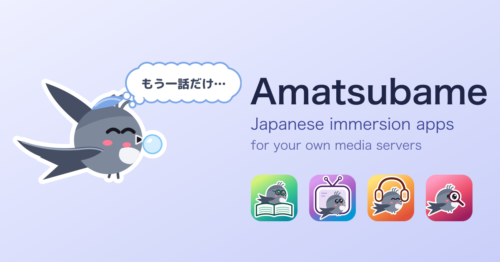
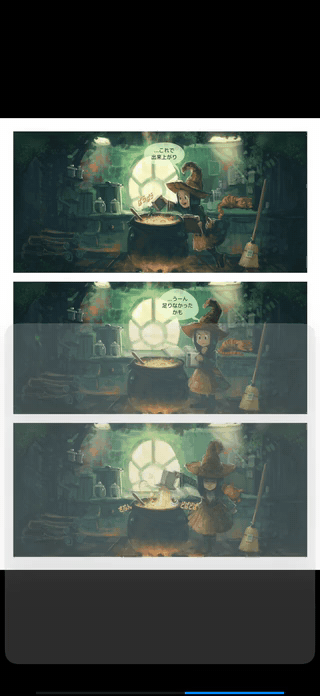
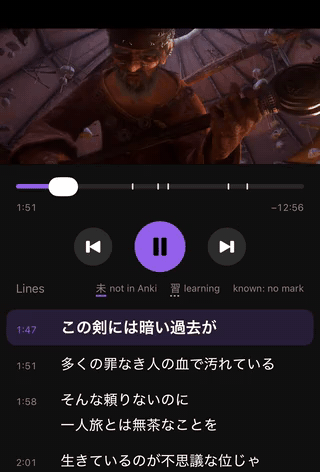
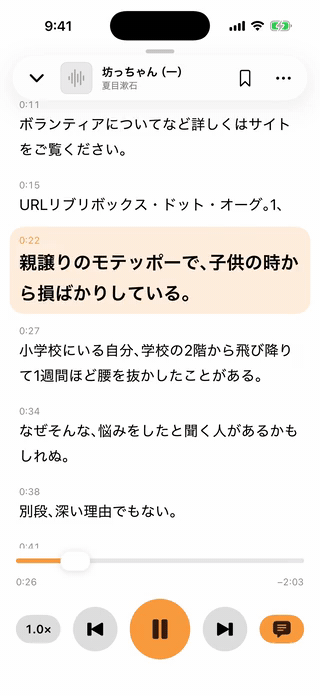
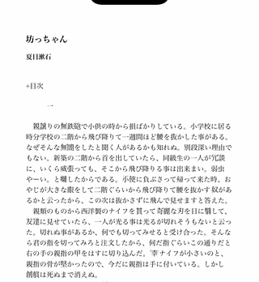

  

  
  
  
  

  Japanese immersion apps for your own Kavita, Jellyfin and Audiobookshelf. 
  One dictionary popup everywhere, and cards straight to Anki.

| | App | | |
| :-: | --- | --- | :-: |
|  | **Yomu** 読む, to read | Manga and light novels from Kavita, with on-device text recognition and read-along |  |
|  | **Miru** 見る, to watch | Jellyfin video with tappable Japanese subtitles |  |
|  | **Kiku** 聞く, to listen | Podcasts and audiobooks from Audiobookshelf with tappable transcripts |  |
|  | **Hiku** 引く, to look up | Tap Japanese on any page in Safari |  |

**Kaku** (書く, to write down) is the optional transcription server behind Kiku's transcripts:
[`Server/kaku`](Server/kaku). No servers of your own? Setup offers demo servers to try the apps with.

  
  

  
  

## Get started

Guides for every app are at [amatsubame.com](https://amatsubame.com). The Mac apps are on
[Homebrew](https://brew.sh) (the iPhone and iPad apps are on TestFlight):

    brew install --cask zacaronii/amatsubame/yomu   # or miru, kiku, hiku

They're signed with Developer ID, notarized and need Apple silicon. Testers can follow every Dev build
with the `@dev` casks instead (`zacaronii/amatsubame/yomu@dev` and so on); a release cask and its
`@dev` cask are the same app, so install one of the two.

## Build from source

    brew install xcodegen
    xcodegen && open Amatsubame.xcodeproj

Requirements, signing for your own devices and more: [docs/BUILDING.md](docs/BUILDING.md).
Developer notes are in [`docs/`](docs).

## Contributing

Bugs and ideas are [GitHub issues](https://github.com/zacaronii/amatsubame/issues/new/choose).
[docs/CONTRIBUTING.md](docs/CONTRIBUTING.md) has the workflow, and [CLAUDE.md](CLAUDE.md) the
project's rules for contributors and coding agents.

### Branches

Work lands in `dev` through pull requests; `main` gets only what has been tried, through one
`dev` → `main` pull request. Details: [docs/CONTRIBUTING.md](docs/CONTRIBUTING.md#branches).

### Releasing

Releases promote a Dev TestFlight build that has been in use: [docs/RELEASING.md](docs/RELEASING.md).

## License

The apps are licensed under the [GNU General Public License, version 3 only (GPL-3.0-only)](LICENSE): they link the GPL-3.0
dictionary engine [hoshidicts](https://github.com/Manhhao/hoshidicts). Kaku is a separate program under
the [MIT License](Server/kaku/LICENSE). Third-party components and their licenses are listed in
[THIRD_PARTY_NOTICES.md](THIRD_PARTY_NOTICES.md).

Amatsubame stands on the work of many people: see [docs/ACKNOWLEDGEMENTS.md](docs/ACKNOWLEDGEMENTS.md).
The GIFs show licence-clean content: [credits](docs/media/CREDITS.md). The demo servers' books, manga,
audiobooks and films are credited in [CREDITS.md](CREDITS.md).
